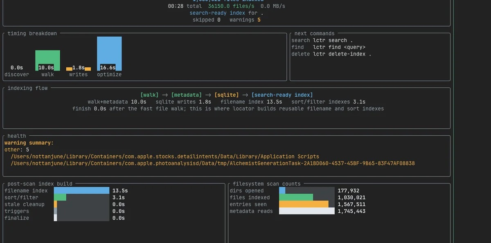
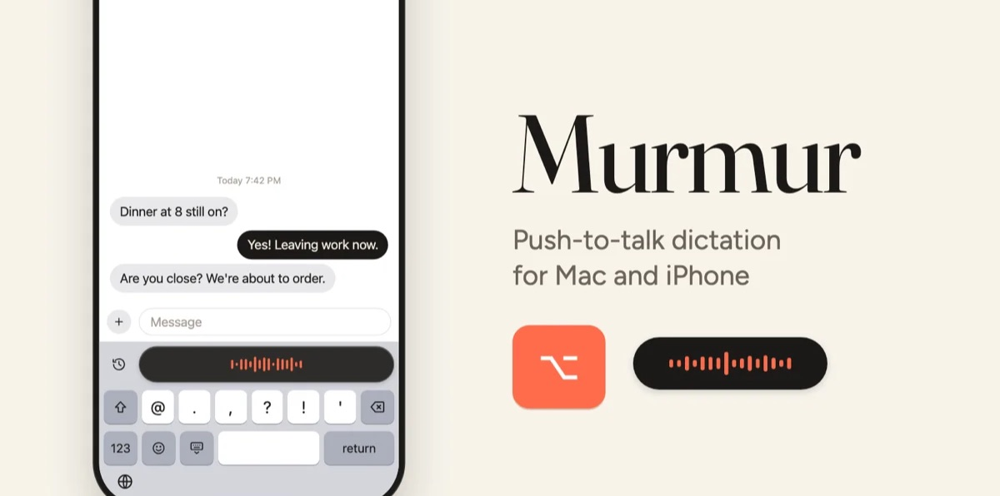
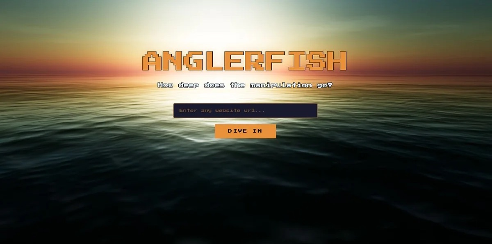
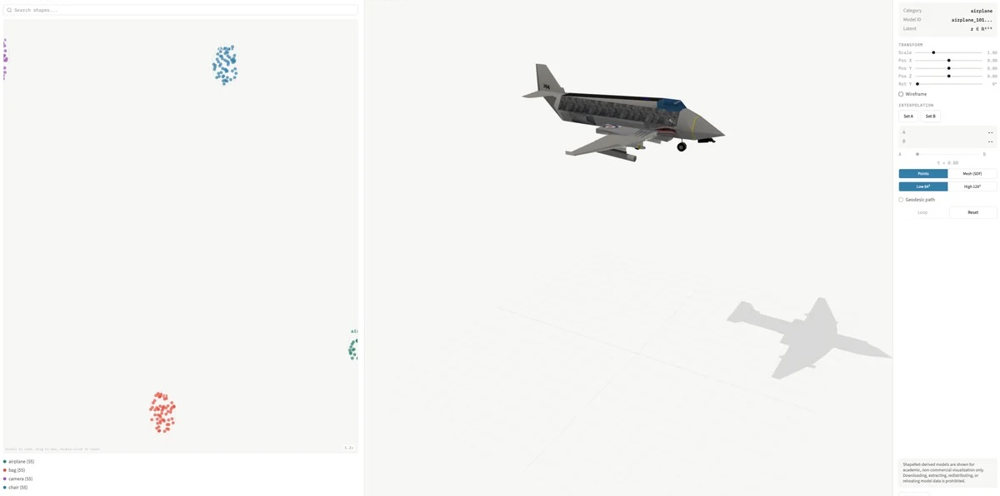

<picture>
  <source media="(prefers-color-scheme: dark)" srcset="assets/banner-dark.svg">
  
</picture>

I'm a Master of Science in Artificial Intelligence student at NTU Singapore, most recently an AI Agents intern at Bosch. I build agent tooling, fast native apps and ML systems, mostly in Rust, Swift and Python. Before NTU I studied mechatronics and spent about two years in industry.

**Open to opportunities** in AI engineering and agentic systems. Reach me through [tanmaynargas.com](https://tanmaynargas.com) or [LinkedIn](https://www.linkedin.com/in/tanmay-nargas-63b723147).

### Featured projects

<table>
  <tr>
    <td width="38%" valign="top">
      
    </td>
    <td width="62%" valign="top">
      <a href="https://github.com/NotTanJune/locator"><b>locator (lctr)</b></a>
       
      Local metadata search for any folder or external drive. A Rust CLI and TUI that answers before Finder has finished loading.
       
      
      
    </td>
  </tr>
  <tr>
    <td width="38%" valign="top">
      
    </td>
    <td width="62%" valign="top">
      <a href="https://github.com/NotTanJune/murmur"><b>Murmur</b></a>
       
      Hold a key, talk, let go. Push-to-talk dictation for macOS plus an iPhone keyboard. Speech and cleanup run on-device.
       
      Swift · on-device ML · macOS and iOS · built on <a href="https://github.com/per-simmons/murmur-youtube">per-simmons/murmur-youtube</a>
    </td>
  </tr>
  <tr>
    <td width="38%" valign="top">
      
    </td>
    <td width="62%" valign="top">
      <a href="https://github.com/NotTanJune/anglerfish"><b>Anglerfish</b></a>
       
      A web agent scans any site for dark patterns, GPT-4o classifies them, and the results play out as a 3D deep-sea descent.
       
      TypeScript · Three.js · web agents · <a href="https://tiny-fish-two.vercel.app">live demo</a>
    </td>
  </tr>
  <tr>
    <td width="38%" valign="top">
      
    </td>
    <td width="62%" valign="top">
      <a href="https://github.com/NotTanJune/AI6131-3D-Deep-Learning"><b>LatentSDF Explorer</b></a>
       
      DeepSDF latent spaces trained on ShapeNet-style data, with reconstruction metrics and a WebGL shape explorer.
       
      Python · PyTorch · Three.js · <a href="https://latentsdf-explorer.vercel.app">live demo</a>
    </td>
  </tr>
</table>

### Recently shipped

<!-- RECENT:START -->
| Repo | What | Pushed |
| --- | --- | --- |
| [murmur](https://github.com/NotTanJune/murmur) | Push-to-talk dictation for macOS | 26 Nov |
| [crack-detection](https://github.com/NotTanJune/crack-detection) | Machine vision project | 26 Nov |
| [Portfolio](https://github.com/NotTanJune/Portfolio) | tanmaynargas.com | 26 Nov |
| [locator](https://github.com/NotTanJune/locator) | Released v0.5.2 | 24 Nov |
| [branch-to-the-future](https://github.com/NotTanJune/branch-to-the-future) | Terminal change-impact simulator | 24 Nov |
<!-- RECENT:END -->

Updated every day by a GitHub Action.

### Hackathons

| Event | Build |
| --- | --- |
| AI Engineer Hackathon 2026 | [Branch to the Future](https://github.com/NotTanJune/branch-to-the-future): blast-radius analysis for a planned code change, in a Ratatui TUI |
| Mistral Worldwide Hackathon 2026 | [DevDéx](https://github.com/NotTanJune/DevDex): scans a codebase and writes the launch kit (privacy policy, store copy, checklist) |
| Build for Impact 2026 | [ReWear SG](https://github.com/NotTanJune/cycleit): clothing reuse prototype |
| PSA Code Sprint 2025 | StrAIt: port network insights with Groq inference and ML forecasting |
| Creatica 2022 | [Harbour](https://github.com/NotTanJune/Harbour) |

### Stack

  

### Activity

<picture>
  <source media="(prefers-color-scheme: dark)" srcset="pacman/pacman-contribution-graph-dark.svg">
  
</picture>

### Elsewhere

[tanmaynargas.com](https://tanmaynargas.com) · [LinkedIn](https://www.linkedin.com/in/tanmay-nargas-63b723147) · [Contact form](https://tanmaynargas.com/contact)

Off the keyboard: guitar for over ten years, cycling, swimming, basketball and story games.
